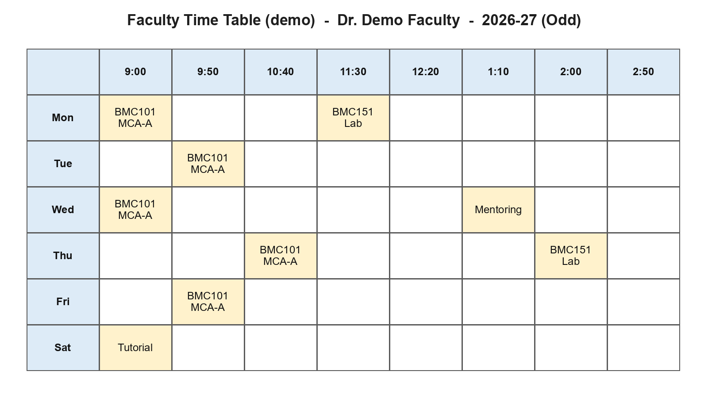

<!-- {fig-align="center" width="100%"} -->

```{r}
#| label: faculty-timetable
#| echo: false
#| message: false
#| warning: false
#| fig-align: center
#| out-width: 100%

library(knitr)

# Locate schema helper
helper_candidates <- c(
  "_data_helpers.R",
  "Course File Resources/_data_helpers.R",
  "../_data_helpers.R",
  "../Course File Resources/_data_helpers.R"
)

helper_path <- helper_candidates[file.exists(helper_candidates)]

if (length(helper_path) == 0L) {
  stop("Cannot locate _data_helpers.R in the project.")
}

source(helper_path[1])

# Read faculty timetable from Excel
timetable_df <- read_workbook_sheet(
  cf_sheet("faculty_time_table")
)

if (is.null(timetable_df) || nrow(timetable_df) == 0L) {
  stop("Faculty timetable worksheet is missing or empty.")
}

# Validate column
if (!"Timetable Location" %in% names(timetable_df)) {
  stop("Column 'Timetable Location' not found.")
}

# Extract image path
paths <- trimws(as.character(
  timetable_df[["Timetable Location"]]
))

paths <- paths[!is.na(paths) & nzchar(paths)]

if (length(paths) == 0L) {
  stop("No timetable image path found.")
}

image_path <- gsub("\\\\", "/", paths[1])

# Resolve image path relative to project root
if (!file.exists(image_path)) {
  image_path <- file.path(
    get_project_root(),
    image_path
  )
}

if (!file.exists(image_path)) {
  stop("Timetable image not found: ", image_path)
}

# Display timetable
knitr::include_graphics(
  normalizePath(image_path, winslash = "/")
)
```
