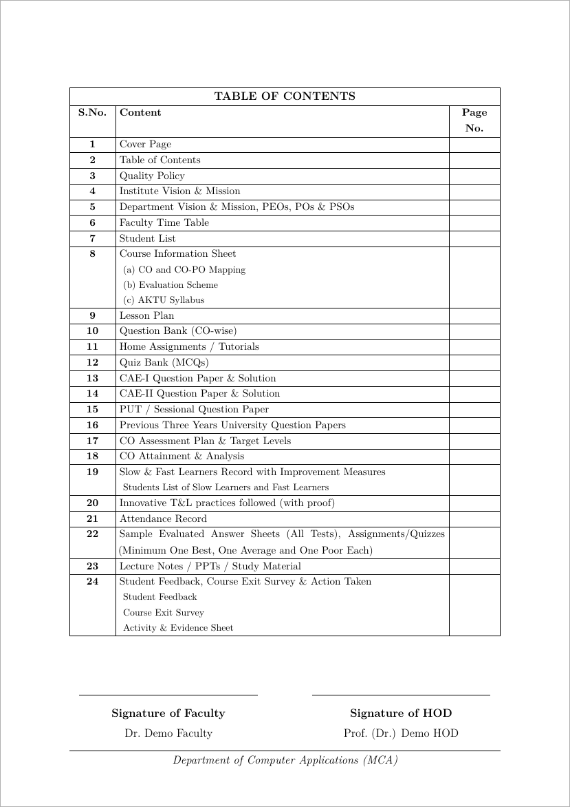
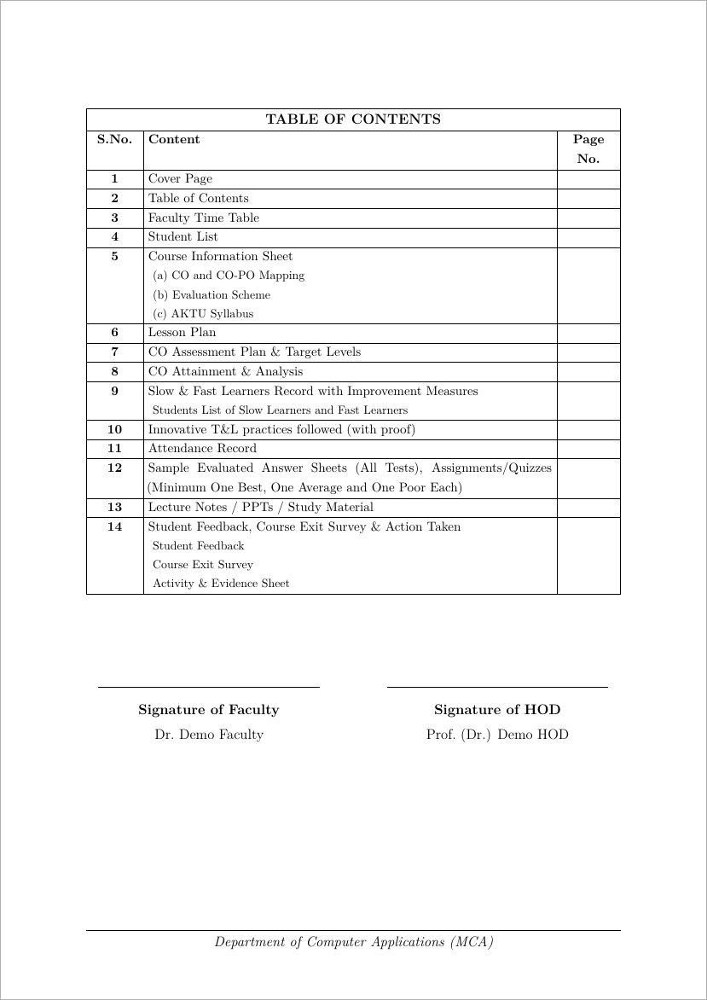
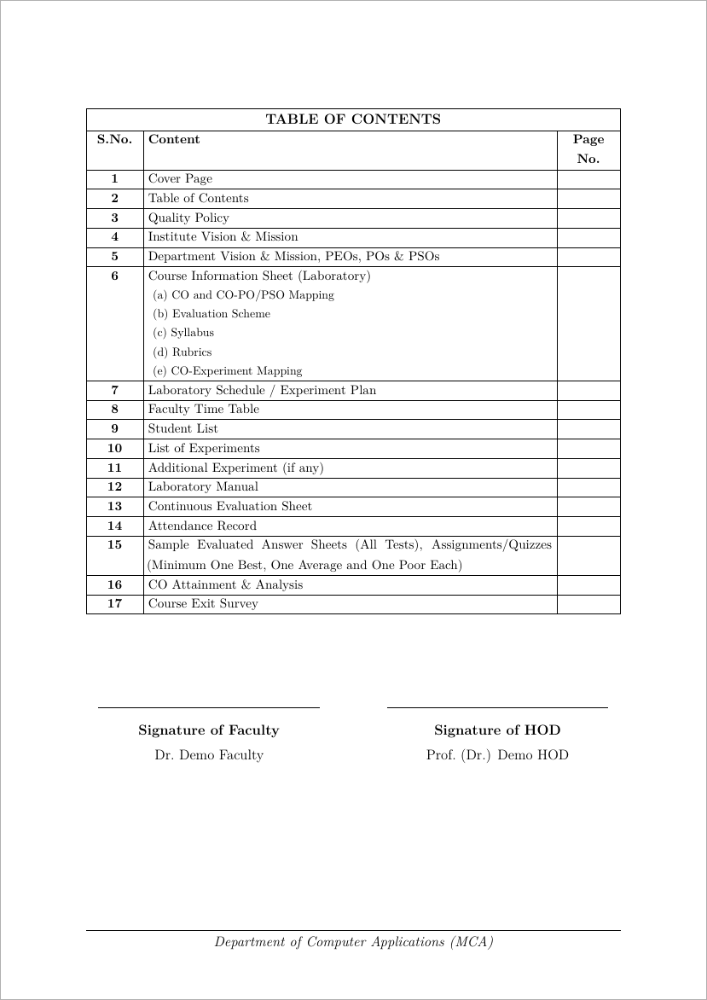

# GCET Course File Template (Quarto)

A reusable [Quarto](https://quarto.org) book template that generates a
GCET-style academic **Course File** — theory or laboratory — as a PDF (or
Word document) directly from **one Excel workbook**.

- **One codebase, three variants:** Course Coordinator, Subject Teacher and
  Laboratory Course.
- **Faculty only edit Excel.** Every per-course value (subject, course code,
  faculty name, which variant to build, ...) is read from the workbook's
  `0.CourseFile_Config` sheet. No course-specific value is hardcoded in the
  template.
- **Ships with demo data.** The included workbook, timetable and evidence
  images are all generated placeholders, so the template renders out of the
  box. See [`sample-output/`](sample-output/) for the resulting PDFs, one
  per variant.

> **All data in this repository is fictitious.** The student names,
> admission numbers, attendance, marks and faculty names in the demo
> workbook are generated, and every evidence image is a placeholder.

## Preview

The title page and table of contents of each variant, rendered from the
demo data. Click a variant name to open its full sample PDF.

| Variant | Title page | Table of contents |
|---|---|---|
| [**Course Coordinator**](sample-output/BMC101-Course-File-Dr-Demo-Faculty.pdf)<br>full theory file, 24 sections |  |  |
| [**Subject Teacher**](sample-output/BMC101-Subject-Teacher-Course-File-Dr-Demo-Faculty.pdf)<br>reduced theory file, 14 sections |  |  |
| [**Laboratory Course**](sample-output/BMC101-Laboratory-Course-File-Dr-Demo-Faculty.pdf)<br>laboratory file, 17 sections |  |  |

## Quick start

1. **Install the prerequisites** (once per computer):
   - [Quarto](https://quarto.org/docs/get-started/) 1.4 or newer
   - [R](https://cran.r-project.org/) 4.2 or newer
   - A LaTeX distribution for PDF output: `quarto install tinytex`
   - The R packages: `Rscript tools/install_packages.R`
2. **Get your own copy.** On GitHub choose **Use this template**, or
   download the repository. Use one copy per course.
3. **Render the demo** to confirm everything works:
   ```bash
   Rscript tools/render_course_file.R
   ```
   The PDF appears in `Course File/`.
4. **Make it yours:** open the workbook in `Course Workbook/`, fill in the
   `0.CourseFile_Config` sheet and the other sheets, replace the placeholder
   images under `Course File Resources/`, and render again.

> **Keep your own course repository private.** A real course file contains
> student names, marks and answer-sheet scans. Do not push those to a
> public repository.

## How it fits together

```
_quarto.yml                      <- shared project config + coursefile.schema (workbook structure)
_quarto-course-coordinator.yml   <- chapter list for the full Course Coordinator file
_quarto-subject-teacher.yml      <- chapter list for the reduced Subject Teacher file
_quarto-laboratory-course.yml    <- chapter list for the Laboratory Course file
index.qmd                        <- book "home page"; also embeds each profile's first chapter
Course Workbook/<WORKBOOK>.xlsx  <- the one Excel file every chapter (and the Config sheet) reads from
Course File Resources/           <- one .qmd per chapter, shared R helpers, and the evidence image folders
_extensions/gcet-course-file/    <- the branded PDF document class/template
tools/                           <- render wrapper, preflight validator, package installer
sample-output/                   <- the three variants rendered from the demo data
docs/screenshots/                <- title page and contents images used in this README
Course File/                     <- GENERATED output (gitignored)
_metadata.yml                    <- GENERATED each render from the workbook's Config sheet (gitignored)
```

Quarto **profiles** control which chapters are included in a render;
`coursefile.schema` in `_quarto.yml` controls *where in the workbook* each
chapter's data comes from; the workbook's **`0.CourseFile_Config`** sheet
supplies the per-course values and picks which profile to use.

## Rendering

**The easy way — let the workbook decide everything:**

```bash
Rscript tools/render_course_file.R          # renders the PDF, profile from the Config sheet
Rscript tools/render_course_file.R docx     # same, but a Word copy
```

This resolves `subject-type` + `faculty-role` from the Config sheet to a
profile, renders it, and names the output
`<course-code>-<Variant>-Course-File-<faculty-name>.ext` in `Course File/`.

In VS Code, the same thing is the default build task (`Ctrl+Shift+B`). On
Windows that task runs `tools/render_course_file.ps1`, which finds
`Rscript.exe` even when it is not on `PATH`.

**The manual way — pick the profile yourself:**

```bash
quarto render --to gcet-course-file-pdf --profile course-coordinator   # full file
quarto render --to gcet-course-file-pdf --profile subject-teacher      # reduced file
quarto render --to gcet-course-file-pdf --profile laboratory-course    # laboratory course file
quarto render --to docx --profile <profile>                            # Word version of any of the above
```

Either way, `Rscript` must be on `PATH` (the `project.pre-render` hook that
regenerates `_metadata.yml` from the workbook needs it).

## The workbook

Put exactly **one** workbook (`.xlsx` or `.xlsm`) in the `Course Workbook/`
folder. Its filename does not matter and is not configured anywhere —
whatever single workbook is in that folder is used. Keep reference
spreadsheets somewhere else.

### The `0.CourseFile_Config` sheet

A two-column `Key` / `Value` sheet. This is the **only thing you need to
edit** to point the template at a different course:

| Key | Example value |
|---|---|
| `subject-type` | `Theory` or `Lab` |
| `faculty-role` | `Course Coordinator` / `Subject Faculty` / `Laboratory Faculty` |
| `institution` | Galgotias College of Engineering and Technology |
| `institution-address` | Plot No. 2, Knowledge Park II, Greater Noida, Uttar Pradesh |
| `department` | Department of Computer Applications |
| `academic-session` | 2026-27 (Odd) |
| `subject-name` | Fundamentals of Computers & Emerging Technologies |
| `course-code` | BMC101 |
| `semester` | I |
| `faculty-name` | Dr. Demo Faculty |
| `faculty-designation` | Assistant Professor |
| `section-name` | MCA Section A |
| `hod-name` | Prof. (Dr.) Demo HOD |

`subject-type` + `faculty-role` together pick the variant:

| Subject | Faculty Role | Profile rendered |
|---|---|---|
| Theory | Course Coordinator | `course-coordinator` (full file) |
| Theory | Subject Faculty | `subject-teacher` (reduced file) |
| Lab | Laboratory Faculty | `laboratory-course` |

Any other combination (or a typo) stops the render with an error listing
the supported combinations, instead of silently building the wrong file.
Every other row becomes a `coursefile.*` value used on the cover page and
in the chapters (``, or
`cf_value("institution")` in R chunks). `faculty-name` and `hod-name` are
printed under the signature blocks.

### Required Register columns

The Register sheet's column headers are **mandated by the template**. They
are defined once in `required_register_columns` in
`Course File Resources/_data_helpers.R`, and the Register sheet must contain
them (in any order or position):

`S. No.`, `Branch / Section`, `Admission No`, `Student Name`,
`CAE-I Attendance`, `CAE-I Marks`, `CAE-II Attendance`, `CAE-II Marks`,
`Assign/Tutorial Grade 1` to `Assign/Tutorial Grade 5`, `Assignment Total`,
`PUT Attendance`, `PUT Marks`

If a workbook genuinely uses a different header, override just that key in
`_quarto.yml`:

```yaml
coursefile:
  schema:
    register_columns:
      student_name: "Name of Student"
```

### Sheets and cell ranges

Sheet names and the cell ranges of the tables inside them are listed under
`coursefile.schema` in `_quarto.yml`. If your workbook follows the demo
workbook's layout you do not need to touch them. Note that the ranges are
fixed (for example `lesson_plan: "A7:I51"` covers 45 lectures): widen a
range there if your course has more rows than the demo.

### Check the workbook before rendering

```bash
Rscript tools/check_workbook.R
```

This prints an `[OK]`/`[FAIL]` line for every configured sheet, every
required Register column, and the Config sheet's variant selection, so a
mismatch is caught immediately instead of partway through a render.

## Evidence images and folders

Chapters that show scans or screenshots read them from folders next to the
chapter files. Replace the demo placeholders with your own files:

| Folder under `Course File Resources/` | What goes there |
|---|---|
| `06_faculty_time_table/` | `faculty_time_table.png` |
| `08_course_information/` | `evaluation_scheme.png`, `syllabus.png` |
| `20_innovative_tl_practices/<activity>/...` | Evidence screenshots (`1.png`, `2.png`, ...) per activity. An activity appears in the chapter when its name in the Lesson Plan sheet's activity column is hyperlinked to its folder. |
| `21_attendance_record/` | Scanned register pages (`.jpg`/`.png`), included in filename order |
| `22_sample_evaluated_sheets/<1.best\|2.average\|3.poor>/<CAE-I\|CAE-II\|PUT>/` | Scanned answer sheets (`1.png`, `2.png`, ...) |
| `23_lecture_notes/` | Lecture note PDFs (create this folder when you have them) |
| `24_student_feedback_survey/` | `1.png` (student feedback), `2.png` (course exit survey) |

The image paths for the timetable, evaluation scheme and syllabus are read
from the workbook (`6.Faculty_TimeTable` and `8.Course_Info` sheets), so
you can point them at differently named files there.

## Adapting the template

### To another department or institution

No LaTeX edits are needed. The Config sheet covers the per-course values,
and the institute/department-wide ones are set under `coursefile:` in
`_quarto.yml`:

| Key in `_quarto.yml` | Where it appears |
|---|---|
| `logo` | Cover page and page header |
| `institution-group` | Cover page, line above the institution name |
| `programme` | Cover page, line above the subject name |
| `header-institution` | Page header, first line |
| `header-address` | Page header, second line |
| `footer-text` | Page footer |

The last three are optional. Remove one and the header/footer falls back to
the Config sheet's `institution` (uppercased), `institution-address` or
`department` value. Any of these keys can also be added as a Config sheet
row, which then wins over `_quarto.yml` for that course.

The assessment names (CAE-I, CAE-II, PUT) follow the AKTU pattern used at
GCET.

### Adding a new profile

1. Create `_quarto-<name>.yml` with a `book.chapters` list (reuse existing
   chapter files where the content applies as-is).
2. Add `<name>` to the `profile.group` list in `_quarto.yml`.
3. Add `<name>` to the `profile_title_suffixes` map in
   `tools/generate_coursefile_metadata.R`.
4. Add the Subject / Faculty Role combination(s) that should map to it in
   `coursefile_profile_map` in `Course File Resources/_data_helpers.R`.
5. If its first chapter differs from the others, add a
   `::: {.content-visible when-profile="<name>"}` block in `index.qmd` —
   but **never include the same file from two different profile blocks**
   (Quarto expands includes before knitr parses chunk labels, so duplicate
   chunk labels fail the render). Use `unless-profile` to share one include.

### Adding a new data-driven chapter

1. Add any new sheet or range it needs under `coursefile.schema` in
   `_quarto.yml`, and any new Register column to
   `required_register_columns` — do not hardcode them in the `.qmd`.
2. Write the chapter with the helpers in `_data_helpers.R` (`cf_sheet()`,
   `cf_range()`, `read_workbook_sheet()`, `get_register_columns()`,
   `render_register_table()`, ...).
3. Reference the new `.qmd` from the relevant profile's `book.chapters` list.
4. Re-run `Rscript tools/check_workbook.R` and a test render.

## How the Config sheet reaches Quarto (for maintainers)

1. `project.pre-render` in `_quarto.yml` runs
   `tools/generate_coursefile_metadata.R` before every render.
2. That script reads the Config sheet and writes `_metadata.yml`, a
   directory-metadata file Quarto discovers automatically, containing
   `book.title`/`book.subtitle` and the full `coursefile:` block.
3. Quarto re-reads project metadata after pre-render scripts run, so the
   values are picked up on every render with no manual step.
4. `tools/render_course_file.R` also resolves the profile itself and
   renames the produced file afterwards, because Quarto computes a book's
   output filename before pre-render scripts run.

## `tools/`

- `render_course_file.R` — renders the variant chosen in the Config sheet
  and names the output file.
- `render_course_file.ps1` — Windows wrapper used by the VS Code build task.
- `check_workbook.R` — preflight validation of the workbook.
- `install_packages.R` — installs the required R packages.
- `generate_coursefile_metadata.R` — the pre-render hook (not run directly).
- `dump_outline.js` — prints a rendered PDF's bookmark tree for a quick
  structure check (`npm install` in `tools/`, then `node tools/dump_outline.js`).

## Known limitations

- The laboratory chapters for the schedule, experiments, manual and
  evaluation sheet are fill-in outlines; they do not yet read from the
  workbook.
- The demo workbook's CO-PO mapping justifications are sample text and do
  not match the demo course's outcomes.
- Table ranges in `coursefile.schema` are fixed, not auto-detected.

## Licence

Released under the [MIT Licence](LICENSE). The Galgotias College of
Engineering and Technology name and logo belong to the institution and are
not covered by that licence.
